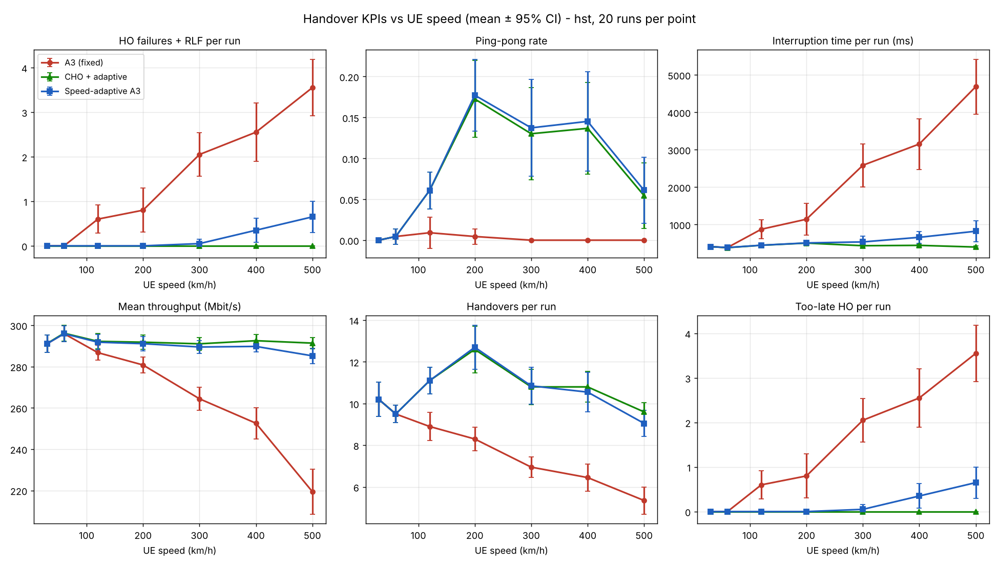
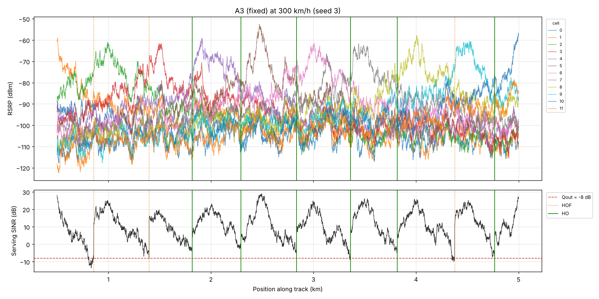

# A3-PS016-TC226: HO-Eval

**AIORI-3 Hackathon · 6G & Future Networks · PS-016: Simulation-Based Handover Decision Evaluation for High-Mobility Users**

| | |
|---|---|
| **Team** | Kondupalli Naga Mrudula · Anke Divya Dharani |
| **Faculty mentor** | Manasa R K |
| **Institution** | Dayananda Sagar College of Engineering (DSCE), Bengaluru |

## Live demo

[](https://colab.research.google.com/github/aiori-hackathon/A3-PS016-TC226/blob/main/demo.ipynb)

Click the badge, then choose **Runtime → Run all**. The notebook ([`demo.ipynb`](demo.ipynb)) clones this repository, runs all three handover policies at high speed, plots each run, and repeats a quick speed sweep. It finishes in about one minute. You can also open `demo.ipynb` on GitHub to see the outputs without running anything.

## Team introduction video

YouTube: https://youtu.be/YOUR_VIDEO_ID

## Presentation

[A3-PS016-TC226.pdf](A3-PS016-TC226.pdf)

---

## 1. Problem

Users on high-speed trains and expressways (120–500 km/h) stay in a cell for only a few seconds. In 5G NR the handover is triggered by the **A3 event** (TS 38.331): the neighbour must exceed the serving cell by an offset plus hysteresis, continuously for a time-to-trigger (TTT). These parameters are **fixed per cell and ignore UE speed**:

* small Hys or short TTT → **ping-pong** handovers and extra signalling
* large Hys or long TTT → **too-late** handovers, HO failures and radio link failures (RLF)

There is no simple, open tool to compare handover policies on identical scenarios using standard KPIs.

## 2. Solution

HO-Eval is a modular Python simulator. Every handover policy plugs into one `HandoverPolicy` interface and runs on **the same channel realisation** (common random numbers), so any KPI difference comes from the policy itself.

| Policy | Idea |
|---|---|
| `A3Policy` (baseline) | Standard A3 with fixed Off 1 dB, Hys 2 dB, TTT 320 ms |
| `SpeedAdaptiveA3` | TTT and Hys scaled by `max(0.25, v_ref / v)` above 60 km/h (extends LTE speed-state scaling, TS 36.331); TTT snapped to the values allowed by the standard |
| `ConditionalHO` | Rel-16 CHO (TS 38.300): a candidate is prepared early (neighbour within 2 dB), and the UE executes on the A3 condition with a speed-adaptive TTT and Hys. The HO command no longer depends on the fading serving link. |

### Models

| Block | Model |
|---|---|
| Mobility | Constant-speed UE on a straight track past 12 gNBs, 30–500 km/h |
| Channel | TR 38.901 UMa-LOS path loss at 3.5 GHz; 4 dB log-normal shadowing, 37 m de-correlation, 0.5 inter-site correlation |
| Measurement | L1 samples every 40 ms with 1 dB error; L3 filter `F = (1−a)F + aM`, k = 4 (TS 38.331) |
| SINR / throughput | Interference from all other cells at 50 % load; truncated Shannon (0.75 × log2(1+SINR), ≤ 5.5 b/s/Hz) |
| HO execution | 50 ms preparation (report → command) and 50 ms interruption. HOF if serving SINR < Qout when the command is due, or target SINR < Qout at execution |
| RLF | Serving SINR < Qout (−8 dB) for T310 = 1000 ms; re-establishment costs 500 ms |
| KPIs (TR 36.839) | HO count, ping-pong (return within 1 s), RLF, HOF, too-late / too-early / wrong-cell, interruption time, mean throughput |

### Architecture

```
ScenarioConfig ─▶ SimulationEngine ─┬─▶ MobilityModel     (mobility.py)
  (configs/*.yaml)  (simulator.py)  ├─▶ ChannelModel      (channel.py)
                                    └─▶ MeasurementModel  (measurement.py)
                                               │ L3-filtered RSRP
                                               ▼
                               «interface» HandoverPolicy.decide()   (policies.py)
                                 ├─ A3Policy
                                 ├─ SpeedAdaptiveA3
                                 └─ ConditionalHO
                                               │ HO / PREPARE / EXECUTE
                                               ▼
                               HOExecutor + RLF monitor  (executor.py)
                                               ▼
                               KPICollector (kpi.py) ─▶ Reporter (analysis.py)
```

## 3. Results

High-speed-train scenario, 4.5 km track (9 cell boundaries), **20 independent runs per speed**, mean ± 95 % CI. Full data: [`results/hst/kpi_summary.csv`](results/hst/kpi_summary.csv).

| Speed (km/h) | Policy | HOF + RLF per run | Ping-pong rate | Interruption (ms) | Mean throughput (Mbit/s) |
|---|---|---|---|---|---|
| 120 | A3 (fixed) | 0.60 ± 0.32 | 0.9 % | 874 | 287 |
| 120 | Speed-adaptive A3 | 0.00 ± 0.00 | 6.1 % | 446 | 292 |
| 120 | CHO + adaptive | 0.00 ± 0.00 | 6.1 % | 445 | 292 |
| 300 | A3 (fixed) | 2.05 ± 0.49 | 0.0 % | 2584 | 264 |
| 300 | Speed-adaptive A3 | 0.05 ± 0.10 | 13.7 % | 535 | 289 |
| 300 | CHO + adaptive | 0.00 ± 0.00 | 13.0 % | 434 | 291 |
| 500 | A3 (fixed) | 3.55 ± 0.63 | 0.0 % | 4686 | 219 |
| 500 | Speed-adaptive A3 | 0.65 ± 0.35 | 6.1 % | 820 | 285 |
| 500 | CHO + adaptive | 0.00 ± 0.00 | 5.5 % | 398 | 291 |



**Observations**

1. **The fixed A3 baseline degrades steadily with speed.** Failures rise from 0 at 60 km/h to 3.55 per run at 500 km/h, almost all of them *too-late* HOs, and throughput falls by about 25 %.
2. **Speed-adaptive A3** removes most failures but raises ping-pong to 6–14 %, because Hys is reduced along with TTT.
3. **CHO + adaptive** had **no failures at any speed** in our runs, and the lowest interruption time.
4. **No single fixed setting suits every speed.** For fixed A3, the best (Hys, TTT) is (0 dB, 640 ms) at 60 km/h but (2 dB, 80 ms) at 300 km/h ([`a3_sweep_60kmh.png`](results/hst/a3_sweep_60kmh.png), [`a3_sweep_300kmh.png`](results/hst/a3_sweep_300kmh.png)). This sweep also suggests keeping Hys and shortening only TTT, which is our next improvement.

The expressway scenario (`configs/highway.yaml`, ISD 750 m) shows the same trend; see [`results/highway/`](results/highway/).



## 4. Repository structure

```
├── demo.ipynb              live demo (Colab)
├── configs/                scenario parameters (hst.yaml, highway.yaml)
├── src/hoeval/             simulator package
│   ├── config.py           ScenarioConfig + YAML loader
│   ├── mobility.py         gNB layout and UE trajectory
│   ├── channel.py          path loss, shadowing, RSRP, SINR, throughput
│   ├── measurement.py      L1 error + L3 filtering
│   ├── policies.py         HandoverPolicy interface, A3, speed-adaptive A3, CHO
│   ├── executor.py         HO execution, HOF and RLF model
│   ├── kpi.py              KPI collector, TR 36.839 failure classification
│   ├── simulator.py        channel builder and parallel experiment runner
│   └── analysis.py         statistics (95 % CI) and plots
├── scripts/
│   ├── run_experiment.py   speed sweep for all policies
│   ├── param_sweep.py      Hys × TTT sweep for fixed A3
│   └── plot_timeline.py    per-run RSRP / SINR / event plots
├── tests/                  unit tests (pytest)
└── results/                CSV results and figures
```

## 5. How to run

```bash
pip install -r requirements.txt

python scripts/run_experiment.py --config configs/hst.yaml --runs 20       # about 20 s on 2 cores
python scripts/run_experiment.py --config configs/highway.yaml --runs 20
python scripts/param_sweep.py --speed 300 --runs 10
python scripts/plot_timeline.py --speed 300 --seed 3

python -m pytest -q tests
```

All results are reproducible: each (speed, run) uses a fixed seed, and the same channel is shared by every policy.

## 6. Next steps

* Tune the speed scaling: keep Hys and shorten only TTT, to bring ping-pong back down.
* Add a speed-estimation error model (the UE speed is currently assumed to be known).
* Cross-validate selected cases against ns-3 5G-LENA.

## References

1. 3GPP TS 38.331, NR RRC protocol specification (A3 event, TTT, L3 filtering, T310)
2. 3GPP TS 38.300, NR and NG-RAN overall description (Conditional HO)
3. 3GPP TR 36.839, Mobility enhancements in heterogeneous networks (HO KPIs)
4. 3GPP TR 38.901, Channel model for 0.5–100 GHz
5. 3GPP TR 38.913, Scenarios and requirements (high-speed train)
6. 3GPP TS 36.331, E-UTRA RRC (speed-state scaling)

## License

MIT, see [LICENSE](LICENSE).
